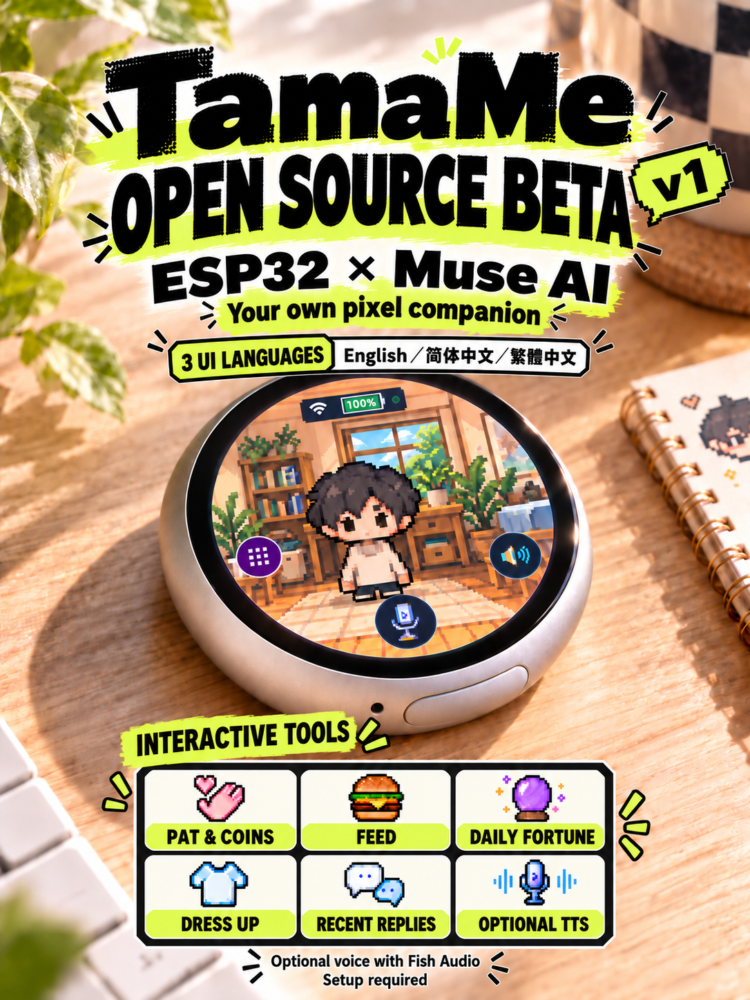
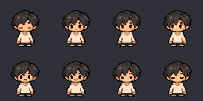
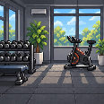

# TamaMe

[English](README.md) · [简体中文](README.zh-CN.md) · [繁體中文](README.zh-TW.md)

The public firmware defaults to English and offers English / 简体中文 / 繁體中文 in Settings. Saving a language restarts the device. Interface language, AI reply language and optional TTS voice settings are separate concerns. See the [language coverage index](LANGUAGES.md).

**Your likeness, your little pixel companion.**

TamaMe is an independent ESP32 desktop pet project based on Muse Gadget SDK. The name combines Tama and Me: an electronic pet that can represent you.

This is a **source preview**, not a ready-to-flash release. The target board is the **Waveshare ESP32-S3-Touch-AMOLED-1.75C**, built with ESP-IDF 6.0.1. Other boards have not been validated by this project.

## Features

Pet interactions, coins, feeding, fortune telling, wardrobe choices, local sound effects, recent replies, and account-backed AI conversations with captions. Optional [Fish Audio TTS](docs/fish-audio.en.md) requires your own configuration. The author has personally verified it in their private build; the public default build has not undergone a live TTS test. **The default build displays captions and does not speak replies.**

A fictional default avatar is included, with five generic scenes: gym, desk, living room, bedroom and café, plus a black background. Clothing and accessories can be mixed. Adaptive scheduling, location control and private-memory automation are not defined or validated public features. Personal avatars currently require local asset conversion and rebuilding; there is no photo upload or on-device avatar import flow.

## Default character and scenes

The public build ships a fictional default character with eight states and five generic scenes, plus a black background. Clothing and accessories can be mixed.

       

States, left to right: boot, error, happy, idle, listening, off, speaking, thinking.

    

Scenes, left to right: bedroom, café, desk, gym, living room.

## Evidence and limits

An isolated build, native tests, asset checks and reviewed-file checks passed. On one target device, the user confirmed the display, opening menus, a successful manual background retest, captions and local interaction sound. Background and clothing survived a reboot. A complete private Flash snapshot was restored and verified before boot, and the user confirmed their original appearance and voice returned.

An initial background-apply failure was not reproduced; its cause remains unknown. Fresh-account pairing, optional TTS, all interaction paths, secure transfer/reset and long-term stability remain unverified. Existing-pairing success is not proof of a clean first-run experience. See [validation status](docs/validation-status.en.md).

## Build and customize

Follow [assembly and build instructions](docs/build-preview.en.md) for the pinned upstream revision and reviewed overlay. Use a new build directory. Before any write, back up your own complete Flash and verify the board, partition table and active app slot; see [storage safety](docs/storage-safety.en.md).

Use your own service account and credentials. Conversations require a network connection; this is not an offline model. TTS may incur service charges. TTS credentials and voice IDs are compiled into a custom build, which must remain private. Never publish device backups, raw conversation logs, private portraits or credentials.

See the [avatar contract](docs/avatar-contract.md), [local tools](docs/avatar-tools.md), [user settings](docs/user-settings.en.md), [data flow](docs/data-flow.md) and [privacy notes](docs/privacy.en.md). The six core user guides are available in English, Simplified Chinese and Traditional Chinese. Other technical guides remain in Traditional Chinese with an English summary.

## Licensing and community

Code: Apache-2.0, subject to retained per-file and third-party notices. Eligible fictional generated artwork: CC0-1.0. Fonts and dependencies retain their own licences. No rights to a user's portrait or voice are granted automatically.

Read [LICENSE](LICENSE), [NOTICE](NOTICE), [third-party notices](THIRD_PARTY_NOTICES.md), [CONTRIBUTING](CONTRIBUTING.md), [SUPPORT](SUPPORT.md) and [SECURITY](SECURITY.md). No endorsement by upstream projects or hardware vendors is implied.

The public profile now bundles a 7,379-codepoint font for common English and Traditional/Simplified Chinese captions; see [font coverage](docs/font-coverage.md). Native LVGL samples passed, but the expanded font has not been accepted on hardware and UI language switching is implemented with a restart after saving; targeted language-switch and wardrobe device checks passed; long-caption and full error-path acceptance remain pending.
