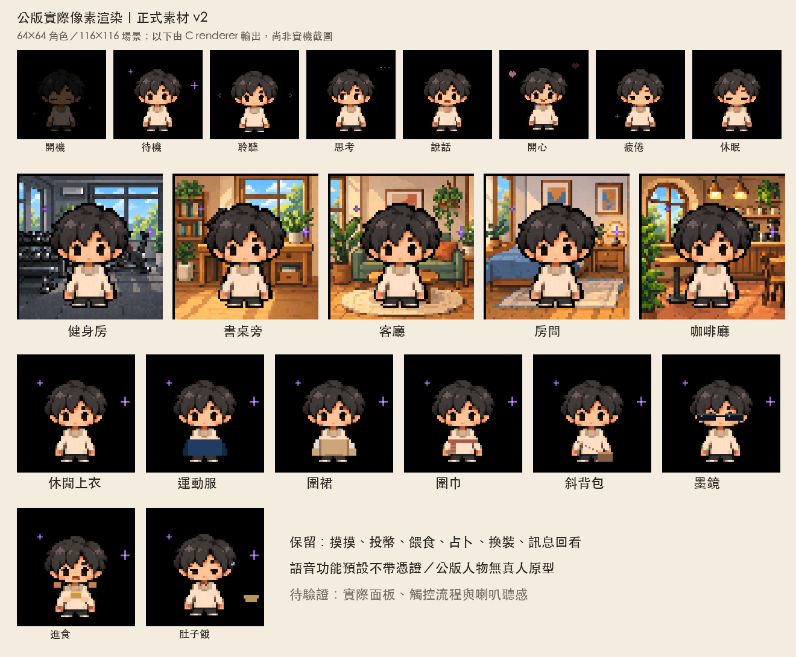

# TamaMe

[English](README.md) · [简体中文](README.zh-CN.md) · [繁體中文](README.zh-TW.md)

公开版固件默认英文，可在设置选择 English／简体中文／繁體中文；保存后重启生效。界面语言、AI 回复语言与选配 TTS 声音是不同设置。完整范围见 [语言覆盖清单](LANGUAGES.md)。

**把自己的形象，变成桌上的像素小伴。**

TamaMe 是基于 Muse Gadget SDK 的 ESP32 个性化桌面电子宠物项目。名称结合 Tama 与 Me，呼应电子宠物和「自己的分身」。这是独立社群改造项目，保留上游来源与署名。

目前提供**源码预览**，不是可直接刷入的正式固件。目标硬件为 **Waveshare ESP32-S3-Touch-AMOLED-1.75C**；其他板型未由本项目验证。

## 可以做什么

- 摸摸、投币、喂食与占卜，搭配本机互动音效。
- 混搭背景、服装、围巾、斜背包与墨镜，保存穿搭选择。
- 通过自己的账号进行 AI 对话，阅读辨识／回复字幕及最近回复。
- 使用公开版虚构人物，或在本机转换自己的角色素材并重新编译。
- 选配 [Fish Audio TTS](docs/fish-audio.zh-CN.md) 与有权使用的声音，作者私人版本已亲测有效。**默认只有字幕，不会朗读回复。**

提供黑底及健身房、书桌旁、客厅、房间、咖啡厅五个场景；服装为休闲上衣、运动服与围裙。「自适应」尚未定义为可验收的公开功能，不宣称具备定位、班表或私人记忆自动控制。

## 已验证到哪里

已完成独立 ESP-IDF 6.0.1 构建、来源／素材检查与原生测试。单台目标设备已确认画面、选单开启、手动背景切换重测、背景／服装重启保存、用户观察的对话字幕与本机音效；完整 Flash 备份与回复原私人版本亦已验证。

首次手动背景套用曾回报未生效，之后重测正常，根因尚未确定。既有配对上的成功对话不代表全新账号配对已通过。TTS、全机清除／转让、完整功能矩阵与长时间稳定性尚未验证。完整范围见 [验证状态](docs/validation-status.zh-CN.md)。

## 开始使用来源

本包是固定上游加上经审核的 `firmware-overlay/`，不是整份 SDK。先依 [源码组装与构建](docs/build-preview.zh-CN.md) 取得固定版本、组装来源，再用新的构建目录编译。

不要直接刷写上游构建工具列出的整组命令。先依 [设置保留与回退](docs/storage-safety.zh-CN.md) 备份当下整颗 Flash、核对板型、分割表与有效 app 分区；不要将别人的设备备份刷入自己的设备。

AI 对话需要自己的网络、账号与配对设置，并非离线模型。TTS 需另行设置，可能产生服务费用；Muse 的这条对话路径不会自动提供回复朗读。未设置语音时的设备提示仍待加入，不能只凭无声判断扬声器故障。

## 自订自己的样貌

默认人物无真人原型，不包含作者照片或私人声音。准备自己的像素角色素材后，参阅 [角色规格](docs/avatar-contract.md) 与 [本机转换工具](docs/avatar-tools.md)。目前采素材转换与重新编译，尚无照片上传、自动生成分身或设备内角色汇入介面。

自己的肖像、声音、密钥与编译产物请私人保存。启用私人 TTS 的密钥与声音 ID 会编译进 app，该 app 不可当作公开版散布。资料去向见 [资料流](docs/data-flow.md) 与 [隐私](docs/privacy.zh-CN.md)。

## 参与与授权

代码采 Apache-2.0，保留各文件与上游通知；本项目可授权的虚构生成美术采 CC0-1.0。字型与第三方元件各自保留原授权，用户肖像／声音不自动取得再散布权利。见 [LICENSE](LICENSE)、[NOTICE](NOTICE)、[美术说明](assets/README.md) 与 [第三方通知](THIRD_PARTY_NOTICES.md)。

回报问题前请读 [SUPPORT](SUPPORT.md)；贡献流程见 [CONTRIBUTING](CONTRIBUTING.md)。安全与隐私问题见 [SECURITY](SECURITY.md)，不要把凭证或完整原始日志贴进公开 Issue。

社区文件 CONTRIBUTING、SUPPORT、SECURITY 目前提供英文与繁体中文，简体中文版待补。角色规格、角色工具及其他维护指南暂为繁体中文，顶部附英文摘要。

公开版配置已内置 7,379 码位字体，支持常见英、繁、简字幕；见 [字体覆盖](docs/font-coverage.md)（英文）。原生 LVGL 三语样本已通过，但扩展字体仍待实机验收，UI 语言切换、指定换装操作和重启保存已通过实机检查；长字幕分页和完整错误路径仍待验收。
