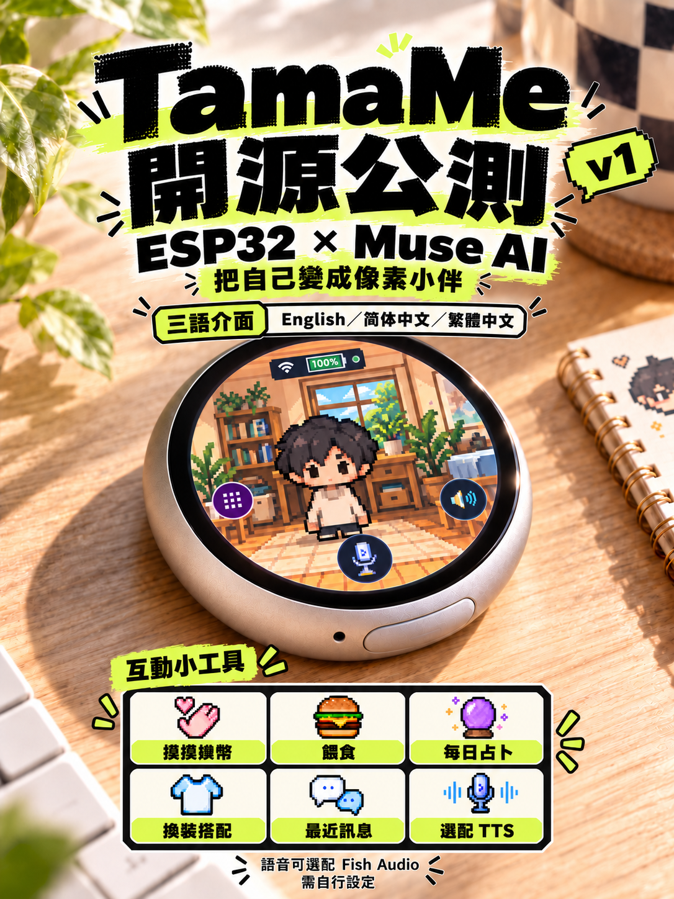

# TamaMe

[English](README.md) · [简体中文](README.zh-CN.md) · [繁體中文](README.zh-TW.md)

公版韌體預設英文，可在設定選擇 English／简体中文／繁體中文；保存後重新啟動生效。介面語言、AI 回覆語言與選配 TTS 聲音是不同設定。完整範圍見 [語言覆蓋清單](LANGUAGES.md)。

**把自己的形象，變成桌上的像素小伴。**

TamaMe 是基於 Muse Gadget SDK 的 ESP32 個人化桌面電子寵物專案。名稱結合 Tama 與 Me，呼應電子寵物和「自己的分身」。這是獨立社群改造專案，保留上游來源與署名。

目前提供**來源預覽**，不是正式即刷韌體。目標硬體為 **Waveshare ESP32-S3-Touch-AMOLED-1.75C**；其他板型未由本專案驗證。

## 可以做什麼

- 摸摸、投幣、餵食與占卜，搭配本機互動音效。
- 混搭背景、服裝、圍巾、斜背包與墨鏡，保存穿搭選擇。
- 透過自己的帳號進行 AI 對話，閱讀辨識／回覆字幕及最近回覆。
- 使用公版虛構人物，或在本機轉換自己的角色素材並重新編譯。
- 選配 [Fish Audio TTS](docs/fish-audio.md) 與有權使用的聲音，作者私人版本已親測有效。**預設只有字幕，不會朗讀回覆。**

提供黑底及健身房、書桌旁、客廳、房間、咖啡廳五個場景；服裝為休閒上衣、運動服與圍裙。「自適應」尚未定義為可驗收的公開功能，不宣稱具備定位、班表或私人記憶自動控制。

## 內建角色與場景

公開版內建一個虛構預設角色，包含八種狀態與五個通用場景，另有黑色背景。服裝與配件可自由搭配。

       

狀態，由左到右：開機、錯誤、開心、待機、聆聽、關機、說話、思考。

    

場景，由左到右：臥室、咖啡廳、書桌、健身房、客廳。

## 已驗證到哪裡

已完成獨立 ESP-IDF 6.0.1 建置、來源／素材檢查與原生測試。單台目標設備已確認畫面、選單開啟、手動背景切換重測、背景／服裝重啟保存、使用者觀察的對話字幕與本機音效；完整 Flash 備份與回復原私人版本亦已驗證。

首次手動背景套用曾回報未生效，之後重測正常，根因尚未確定。既有配對上的成功對話不代表全新帳號配對已通過。TTS、全機清除／轉讓、完整功能矩陣與長時間穩定性尚未驗證。完整範圍見 [驗證狀態](docs/validation-status.md)。

## 開始使用來源

本套件是固定上游加上經審核的 `firmware-overlay/`，不是整份 SDK。先依 [來源組裝與建置](docs/build-preview.md) 取得固定版本、組裝來源，再用新的建置目錄編譯。

不要直接刷寫上游建置工具列出的整組命令。先依 [設定保留與回退](docs/storage-safety.md) 備份當下整顆 Flash、核對板型、分割表與有效 app 分區；不要將別人的設備備份刷入自己的設備。

AI 對話需要自己的網路、帳號與配對設定，並非離線模型。TTS 需另行設定，可能產生服務費用；Muse 的這條對話路徑不會自動提供回覆朗讀。未設定語音時的裝置提示仍待加入，不能只憑無聲判斷喇叭故障。

## 自訂自己的樣貌

預設人物無真人原型，不包含作者照片或私人聲音。準備自己的像素角色素材後，參閱 [角色規格](docs/avatar-contract.md) 與 [本機轉換工具](docs/avatar-tools.md)。目前採素材轉換與重新編譯，尚無照片上傳、自動生成分身或裝置內角色匯入介面。

自己的肖像、聲音、金鑰與編譯產物請私人保存。啟用私人 TTS 的金鑰與聲音 ID 會編譯進 app，該 app 不可當作公版散布。資料去向見 [資料流](docs/data-flow.md) 與 [隱私](docs/privacy.md)。

## 參與與授權

程式碼採 Apache-2.0，保留各檔案與上游通知；本專案可授權的虛構生成美術採 CC0-1.0。字型與第三方元件各自保留原授權，使用者肖像／聲音不自動取得再散布權利。見 [LICENSE](LICENSE)、[NOTICE](NOTICE)、[美術說明](assets/README.md) 與 [第三方通知](THIRD_PARTY_NOTICES.md)。

回報問題前請讀 [SUPPORT](SUPPORT.zh-TW.md)；貢獻流程見 [CONTRIBUTING](CONTRIBUTING.zh-TW.md)。安全與隱私問題見 [SECURITY](SECURITY.zh-TW.md)，不要把憑證或完整原始日誌貼進公開 Issue。

公版設定已內建 7,379 碼位字型，支援常見英、繁、簡字幕；見 [字型範圍](docs/font-coverage.md)（英文）。原生 LVGL 三語樣本通過，但擴充字型仍待實機驗收，UI 語言切換、指定換裝操作與重啟保存已通過實機檢查；長字幕分頁及完整錯誤路徑仍待驗收。
